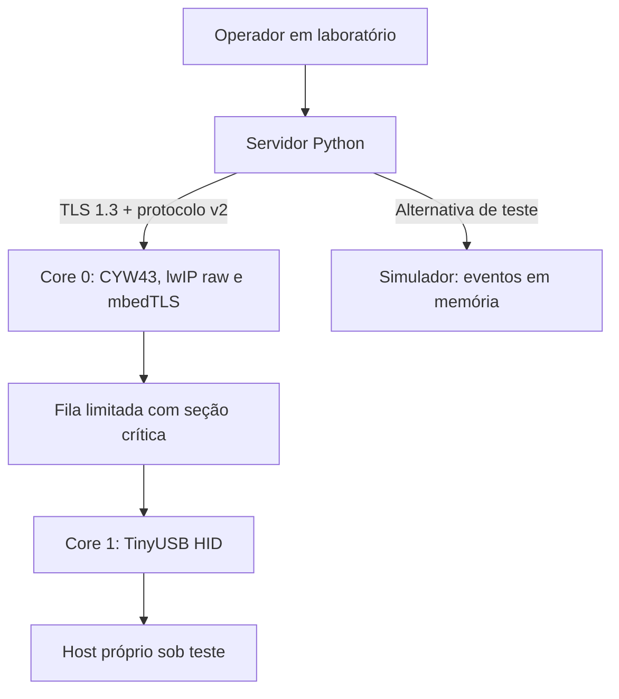

# HIDra

Pesquisa de USB HID em laboratório próprio. O firmware mantém rede/TLS no Core 0 e
TinyUSB no Core 1. O servidor Python envia comandos autenticados; o simulador registra
os eventos em memória e **não emite teclas**.

**Estado:** implementação em validação. Builds e testes de host não comprovam
funcionamento físico. Pico W e Pico 2 W são alvos de compilação separados. Veja a
[matriz de validação](docs/VALIDATION.md) antes de usar qualquer imagem.

## Evidências e limites

- [Auditoria inicial](docs/AUDIT_INITIAL.md): leitura da base antes das alterações.
- [Relatório de correções](docs/AUDIT.md): severidade, evidência e riscos residuais.
- [Protocolo v2](docs/PROTOCOL.md): formato, autenticação, limites e replay.
- [Modelo de ameaças](docs/SECURITY.md): o que é protegido e o que permanece fora do escopo.
- [Laboratório e build](docs/LAB.md): passos reproduzíveis e versões fixadas.
- [Resultados](docs/VALIDATION.md) e [logs](evidence/): testes efetivamente executados.

Não há comprovação de operação em USB/Wi-Fi físico, medição de pico de heap/stack,
benchmark de latência, secure boot ou proteção de segredos em flash. O relógio do
firmware usa uma estimativa ancorada no build; não é uma fonte confiável de hora civil.

## Arquitetura



O servidor serializa cada par comando/resposta. Autenticação exige token e HMAC
independentes. Dois nonces vinculam a sessão; sequência e direção fazem parte do
HMAC. Erro de integridade encerra a conexão. O protocolo legado é incompatível:
servidor, simulador e firmware devem ser atualizados juntos.

A fila tem 64 posições e capacidade útil de 63 registros. `ok:true` confirma
**conclusão da fila de relatórios no firmware**, não observação de uma tecla pelo sistema operacional.
No simulador confirma somente registro em memória. A desconexão
cancela registros pendentes; efeitos já emitidos não podem ser revertidos.

## Executar os testes

Linux, Python 3.11+, OpenSSL e compilador C com headers OpenSSL:

```bash
python3 test/run_tests.py
bash test/run_native.sh
```

O primeiro comando cria certificados temporários, usa somente loopback com portas
efêmeras e valida também o codec C real. O segundo executa o parser e a fila sob
ASan/UBSan. Nenhum deles requer GUI, pyautogui, dispositivo USB ou acesso à rede externa.
O teste adicional da configuração mbedTLS requer a dependência fixada:

```bash
export PICO_MBEDTLS_PATH=/caminho/para/mbedtls
bash test/run_mbedtls_host.sh
```

## Simulação manual

A partir da raiz do repositório:

```bash
bash gen_certs.sh lab-certs
export RUNNER_TOKEN="$(openssl rand -hex 32)"
export RUNNER_HMAC_SECRET="$(openssl rand -hex 32)"
export RUNNER_CERT="$PWD/lab-certs/server.pem"
export RUNNER_KEY="$PWD/lab-certs/server.key"
export RUNNER_CA_CERT="$PWD/lab-certs/ca.pem"
python3 server/c2_server.py --script server/example_payload.duck &
python3 test/pico_agent_sim.py
wait
```

As variáveis são herdadas pelos dois processos. O script de exemplo contém apenas
texto, Enter e delay; o simulador registra esses eventos sem atuar no desktop.
Servidor e simulador usam `127.0.0.1:9000` por padrão. O servidor encerra após o
primeiro agente autenticado concluir o script ou após falha nesse script.

## Firmware

Dependências: pico-sdk **2.3.1**, mbedTLS externo **3.6.8**, Arm GNU Toolchain
**14.3.rel1**. Commits e SHA-256 estão em [dependencies.lock.json](dependencies.lock.json).
O mbedTLS 3.6.6 incluído no SDK não é usado. TinyUSB e lwIP seguem os commits do SDK.

Após provisionar `agent_config.local.h` e `ca_cert.h` conforme [LAB.md](docs/LAB.md):

```bash
export PICO_SDK_PATH=/caminho/para/pico-sdk
export PICO_MBEDTLS_PATH=/caminho/para/mbedtls
bash scripts/build_firmware.sh pico_w
bash scripts/build_firmware.sh pico2_w
```

As saídas ficam em `firmware/build-<placa>/pico_c2_agent.uf2`. Não publique binários
provisionados: eles contêm credenciais recuperáveis. CI usa valores públicos de
compilação e não publica UF2/ELF.

## Implementado e pendente

| Implementado e verificável no código/testes | Ainda depende de validação ou desenvolvimento |
|---|---|
| TLS 1.3, CA e hostname; HMAC obrigatório | Hora civil confiável no dispositivo |
| Nonces por sessão, sequência e separação de direção | Provisionamento individual e rotação sem rebuild |
| Parsing limitado, rejeição de entradas inválidas | Testes físicos de desconexão, suspensão e retomada USB |
| Rate limit, prazos e backoff limitado | Medição de heap/stack sob falhas e tráfego prolongado |
| Servidor, simulador sem efeitos e codec C cruzado | Soak test em RP2040 e RP2350 |
| Builds separados e GitHub Actions | Secure boot, flash protegida e isolamento de credenciais |

Use somente dispositivos, redes e hosts próprios, com consentimento. O projeto não
implementa evasão, persistência, acesso ao shell ou execução remota de processos.
Comandos HID ainda podem ter efeitos no host físico, conforme o foco da janela.
